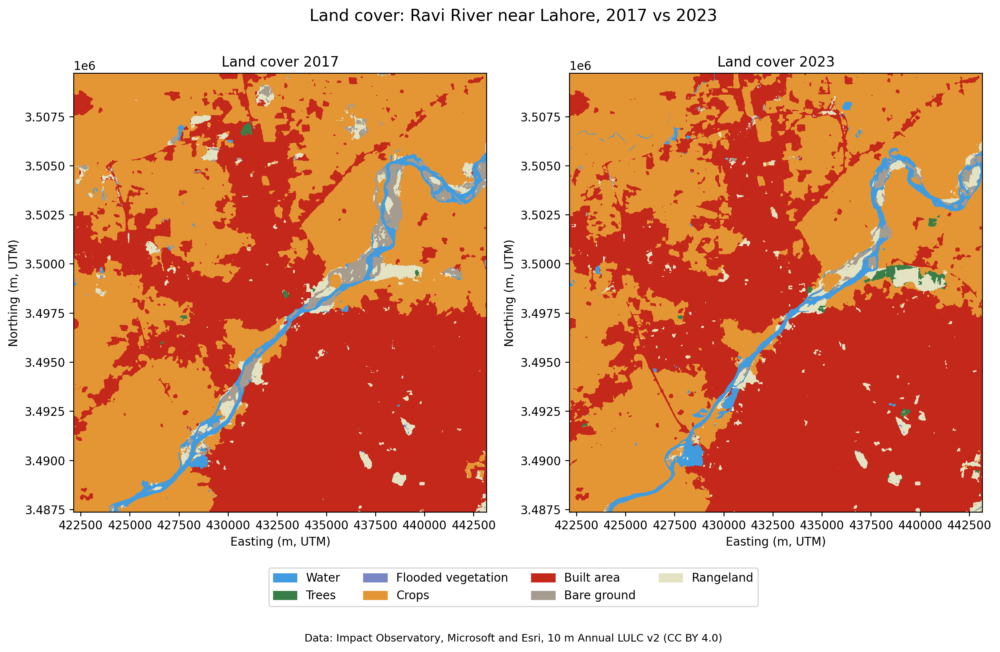

# Land Cover Change Explorer

Measure how land cover changed between two years for any area, using open 10 m satellite land cover data in Google Colab. The default example is the Ravi River near Lahore, Pakistan, 2017 to 2023.

## Why this project

At WaterSprint I worked with land use data as an input to hydrological models (wflow and HydroMT). Land cover controls how much rain runs off and how much soaks in, so knowing where farmland is being built over matters for flood and water planning. I built this project to learn how to measure that change myself, with open data and Python.

## Case study: the Ravi River near Lahore

**Question:** How did land cover change along the Ravi near Lahore between 2017 and 2023, and how much farmland became built-up?

**Study area:** a box of about 21 × 22 km (469 km²) from 74.18°E to 74.40°E and 31.52°N to 31.72°N, covering the river and the western edge of Lahore.

### Results

Between 2017 and 2023, built-up area grew by about **2,490 ha** (roughly 25 km²) and cropland shrank by about **1,960 ha**. About **2,645 ha of cropland became built area**, which is around 88% of all land that became built-up in this period.

Net change by class:

| Class | 2017 (ha) | 2023 (ha) | Change (ha) |
|---|---:|---:|---:|
| Crops | 22,563 | 20,599 | −1,964 |
| Built area | 20,924 | 23,414 | +2,490 |
| Bare ground | 1,103 | 368 | −735 |
| Rangeland | 1,224 | 1,196 | −28 |
| Water | 1,052 | 1,157 | +105 |
| Trees | 50 | 182 | +133 |

Largest conversions:

| From (2017) | To (2023) | Hectares |
|---|---|---:|
| Crops | Built area | 2,645 |
| Rangeland | Crops | 378 |
| Bare ground | Crops | 376 |
| Built area | Crops | 334 |
| Water | Crops | 324 |

Full tables: [change matrix](examples/ravi_lahore/change_matrix_2017_2023_ha.csv) and [top conversions](examples/ravi_lahore/top_conversions_2017_2023_ha.csv).

The riverbed also changed: much of the bare ground (sandbars) along the channel in 2017 was water or rangeland by 2023. This could reflect real changes to the channel or different water levels in the two years, and this data alone cannot separate the two.

## Method

1. **Find the data.** Search Microsoft's Planetary Computer catalogue (STAC) for the land cover tile covering the study area in each year.
2. **Load and clip.** Read only the study area from each Cloud-Optimised GeoTIFF, in its native UTM projection (EPSG:32643 for this area), so every pixel is 10 × 10 m.
3. **Check the data.** Count pixels per class, check for missing data, and confirm both years sit on the same grid, which is required for a pixel-by-pixel comparison.
4. **Map.** Plot both years side by side in the official class colours.
5. **Measure change.** Cross-tabulate every pixel's 2017 class against its 2023 class, then convert pixel counts to hectares (1 pixel = 0.01 ha).

## Run it for your own area

1. Click **Open in Colab** above.
2. In the **Settings** cell, enter a place name, your box's coordinates (west, south, east, north, in degrees) and two years.
3. Click **Runtime → Run all**. The notebook downloads a map and two CSV tables when it finishes.

Notes:

- Always use **Run all** after changing settings. Running single cells can mix results from different settings.
- The notebook checks your inputs and explains any problem in a red box under the settings.
- To find coordinates, right-click a point in Google Maps. It shows latitude first, then longitude.

## Data

[10 m Annual Land Use Land Cover (9-class), version 2](https://planetarycomputer.microsoft.com/dataset/io-lulc-annual-v02), produced by Impact Observatory, Microsoft and Esri from ESA Sentinel-2 imagery, accessed through Microsoft's Planetary Computer. Licensed under CC BY 4.0.

The maps begin in 2017. As of October 2026, the latest year available is 2023. The notebook checks the catalogue each time it runs, so newer years will work automatically once they are published.

## Limitations

- **The maps are model predictions, not ground truth.** The producers report an average accuracy of over 75%, so some apparent change is classification error. For example, 334 ha of built area appears to become cropland, which is unlikely in six years and is probably mostly error.
- **Results describe this dataset, not field conditions.** Changes along the river may reflect water levels on the imagery dates rather than permanent change.
- **One tile only.** The tool stops if the study area crosses a tile boundary, rather than joining tiles.
- **Area limit.** Each side of the box must be under 0.5° (about 50 km) to fit in Colab's memory.

## How this project developed

I first built the analysis as a single study of the Ravi, working step by step in Colab. I then rebuilt it as a reusable tool, with all settings in one form, input checks with clear error messages, automatic detection of available years, and handling of missing data. Problems I solved along the way included web basemaps being blocked in Colab, a catalogue search returning an extra year's map because of overlapping date ranges, and stale results from running cells out of order.

I built this project, including drafting this README, with AI assistance (Claude). I ran, tested and debugged each step, and I can explain how every part works.

## Repository contents

- `landcover_change.ipynb`: the notebook (tool and case study)
- `examples/ravi_lahore/`: map and tables for the Ravi case study
- `LICENSE`: MIT licence for the code

## Author

Abeera Ahmed, civil engineer (NUST, 2025) with experience in water resources and climate analysis, including hydrological modelling and land use work in QGIS.
