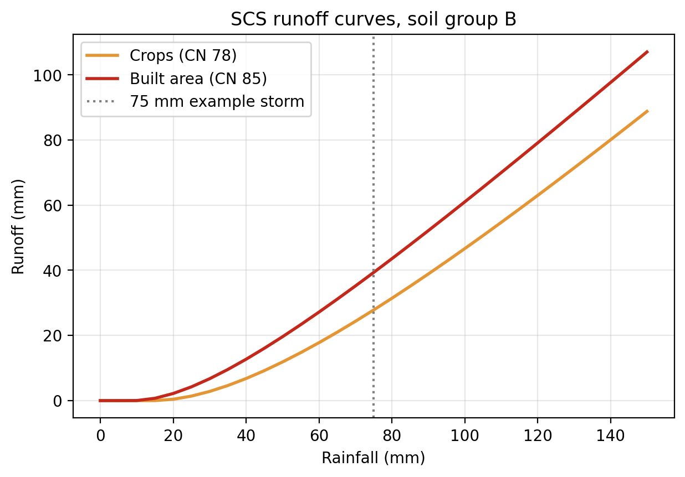

# Land Cover Change Explorer

Measure how land cover changed between two years for any area, using open 10 m satellite land cover data in Google Colab. The default example is the Ravi River near Lahore, Pakistan, 2017 to 2023.

## Why this project

At WaterSprint I worked with land use data as an input to hydrological models (wflow and HydroMT). Land cover controls how much rain runs off and how much soaks in, so knowing where farmland is being built over matters for flood and water planning. I built this project to learn how to measure that change myself, with open data and Python.

## Case study: the Ravi River near Lahore

**Question:** How did land cover change along the Ravi near Lahore between 2017 and 2023, how much farmland became built-up, and what might that mean for runoff?

**Study area:** a box of about 21 × 22 km (469 km²) from 74.18°E to 74.40°E and 31.52°N to 31.72°N, covering the river and the western edge of Lahore.

### Results

According to the map, between 2017 and 2023 built-up area grew by about **2,490 ha** (roughly 25 km²) and cropland shrank by about **1,960 ha**. About **2,645 ha of cropland became built area**, which is around 88% of all land that became built-up in this period. My accuracy check (below) shows these pixel-level figures should be treated as approximate.

Net change by class:

| Class | 2017 (ha) | 2023 (ha) | Change (ha) |
|---|---:|---:|---:|
| Crops | 22,563 | 20,599 | −1,964 |
| Built area | 20,924 | 23,414 | +2,490 |
| Bare ground | 1,103 | 368 | −735 |
| Rangeland | 1,224 | 1,196 | −28 |
| Water | 1,052 | 1,157 | +105 |
| Trees | 50 | 182 | +133 |

Largest conversions:

| From (2017) | To (2023) | Hectares |
|---|---|---:|
| Crops | Built area | 2,645 |
| Rangeland | Crops | 378 |
| Bare ground | Crops | 376 |
| Built area | Crops | 334 |
| Water | Crops | 324 |

Full tables: [change matrix](examples/ravi_lahore/change_matrix_2017_2023_ha.csv) and [top conversions](examples/ravi_lahore/top_conversions_2017_2023_ha.csv).

The riverbed also changed: much of the bare ground (sandbars) along the channel in 2017 was water or rangeland by 2023. This could reflect real changes to the channel or different water levels in the two years, and this data alone cannot separate the two.

### Accuracy check

I checked 40 randomly chosen changed pixels against historical Esri Wayback imagery (versions from January 2018 and August 2023), judging only the exact point and using fixed rules set before starting. Each point was assessed visually, with AI assistance as a second opinion. Results: [accuracy_points_2017_2023.csv](examples/ravi_lahore/accuracy_points_2017_2023.csv).

| Change reported by the map | Points | Confirmed | Not confirmed | Unclear (edge) |
|---|---:|---:|---:|---:|
| Crops → Built area | 30 | 8 | 12 | 10 |
| Built area → Crops | 10 | 0 | 10 | 0 |

**Crops → Built area:** new construction was confirmed at 8 of the 20 points that could be judged (40%), although at 3 of these the land was scrub or trees rather than cropland in 2018. Ten points fell within about 20 m of a built/unbuilt boundary. Most unconfirmed points lay close to real new construction, and three sat on a motorway or railway that already existed in 2018 but was labelled as crops in the 2017 map.

**Built area → Crops:** none of the 10 points showed real change, which supports treating this 334 ha as classification error.

**What this means:** the expansion of built-up land is clearly visible in the imagery, but individual changed pixels are often misplaced, especially near edges, so the 2,645 ha figure should be treated as approximate. The check only tested changes the map reported, not changes it missed, so it cannot correct the total. With 20 judgeable points the estimate is rough: the true confirmation rate could plausibly be anywhere from about 20% to 60%.

### Runoff implications

To link the land cover change to hydrology, I assigned each class an SCS curve number (standard TR-55 values, average moisture conditions) and calculated the area-weighted curve number and the runoff from an illustrative 75 mm storm. Soil group B is the main assumption, based on descriptions of the district's soils as silt loam or very fine sandy loam; group C is included as a sensitivity check.

| Soil group | Weighted CN 2017 | Weighted CN 2023 | Runoff 2017 (mm) | Runoff 2023 (mm) | Extra runoff per storm (m³) |
|---|---:|---:|---:|---:|---:|
| B | 81.5 | 81.7 | 33.9 | 34.3 | ~204,000 |
| C | 87.5 | 87.7 | 44.4 | 44.8 | ~164,000 |

Across the whole area the increase is small, about 1%, under either soil group. The change covers only about 5% of the area, much of the box was already built-up or stayed farmland, and the loss of 735 ha of bare ground (which also has a high curve number) partly offsets the new built area.

Locally the effect is much larger. Where cropland (CN 78) became built area (CN 85), the same 75 mm storm produces about 39 mm of runoff instead of 28 mm, roughly 40% more, and runoff starts after about 9 mm of rain instead of 14 mm.

Full table: [runoff_cn_2017_2023.csv](examples/ravi_lahore/runoff_cn_2017_2023.csv).

## Method

1. **Find the data.** Search Microsoft's Planetary Computer catalogue (STAC) for the land cover tile covering the study area in each year.
2. **Load and clip.** Read only the study area from each Cloud-Optimised GeoTIFF, in its native UTM projection (EPSG:32643 for this area), so every pixel is 10 × 10 m.
3. **Check the data.** Count pixels per class, check for missing data, and confirm both years sit on the same grid, which is required for a pixel-by-pixel comparison.
4. **Map.** Plot both years side by side in the official class colours.
5. **Measure change.** Cross-tabulate every pixel's 2017 class against its 2023 class, then convert pixel counts to hectares (1 pixel = 0.01 ha).
6. **Check accuracy.** Draw random changed pixels with a fixed seed and export their coordinates for visual checking against historical imagery.
7. **Estimate runoff.** Assign curve numbers by class and apply the SCS runoff equation to an example storm.

## Run it for your own area

1. Click **Open in Colab** above.
2. In the **Settings** cell, enter a place name, your box's coordinates (west, south, east, north, in degrees) and two years.
3. Click **Runtime → Run all**. The notebook downloads a map, three CSV tables and a runoff chart when it finishes.

Notes:

- Always use **Run all** after changing settings. Running single cells can mix results from different settings.
- The notebook checks your inputs and explains any problem in a red box under the settings.
- To find coordinates, right-click a point in Google Maps. It shows latitude first, then longitude.
- The notebook also downloads a blank `accuracy_points` CSV with 40 random changed points. To check the map's accuracy for your area, look up each point in historical imagery (for example Esri World Imagery Wayback) and fill in the `real_change` and `notes` columns.
- The runoff section assumes soil group B and uses curve numbers for the Ravi case. Check that these suit your area before relying on them.

## Data

[10 m Annual Land Use Land Cover (9-class), version 2](https://planetarycomputer.microsoft.com/dataset/io-lulc-annual-v02), produced by Impact Observatory, Microsoft and Esri from ESA Sentinel-2 imagery, accessed through Microsoft's Planetary Computer. Licensed under CC BY 4.0.

The maps begin in 2017. As of October 2026, the latest year available is 2023. The notebook checks the catalogue each time it runs, so newer years will work automatically once they are published.

Accuracy points were checked against Esri World Imagery Wayback. Curve numbers are standard USDA TR-55 values.

## Limitations

- **The maps are model predictions, not ground truth.** The producers report an average accuracy of over 75%, but my own spot-check confirmed only 8 of 20 judgeable crops → built points (see Accuracy check), with most errors near built-up edges.
- **Results describe this dataset, not field conditions.** Changes along the river may reflect water levels on the imagery dates rather than permanent change.
- **The runoff estimate is indicative, not a flood model.** It assumes one soil group for the whole area, one curve number per class, average moisture conditions and an illustrative storm, and it ignores drainage networks and routing.
- **One tile only.** The tool stops if the study area crosses a tile boundary, rather than joining tiles.
- **Area limit.** Each side of the box must be under 0.5° (about 50 km) to fit in Colab's memory.

## Possible improvements

- Join neighbouring tiles so study areas can cross tile boundaries.
- Restructure the notebook into reusable functions.
- Add a year-by-year trend chart (2017–2023) to show when change happened.
- Use a mapped soil group dataset instead of a single assumed soil group.

## How this project developed

I first built the analysis as a single study of the Ravi, working step by step in Colab. I then rebuilt it as a reusable tool, with all settings in one form, input checks with clear error messages, automatic detection of available years, handling of missing data and pinned library versions. After feedback, I added explanations inside the notebook, an accuracy check against historical imagery, and a runoff analysis that links the land cover change to hydrology. Problems I solved along the way included web basemaps being blocked in Colab, a catalogue search returning an extra year's map because of overlapping date ranges, and stale results from running cells out of order.

I built this project, including drafting this README and as a second opinion when assessing the accuracy points, with AI assistance (Claude). I ran, tested and debugged each step, and I can explain how every part works.

## Repository contents

- `landcover_change.ipynb`: the notebook (tool and case study)
- `examples/ravi_lahore/landcover_2017_2023.png`: land cover maps for both years
- `examples/ravi_lahore/change_matrix_2017_2023_ha.csv` and `top_conversions_2017_2023_ha.csv`: change tables
- `examples/ravi_lahore/accuracy_points_2017_2023.csv`: the 40 checked points and my assessments
- `examples/ravi_lahore/runoff_cn_2017_2023.csv` and `runoff_curves_2017_2023.png`: runoff results and chart
- `LICENSE`: MIT licence for the code

## Author

Abeera Ahmed, civil engineer (NUST, 2025) with experience in water resources and climate analysis, including hydrological modelling and land use work in QGIS.
